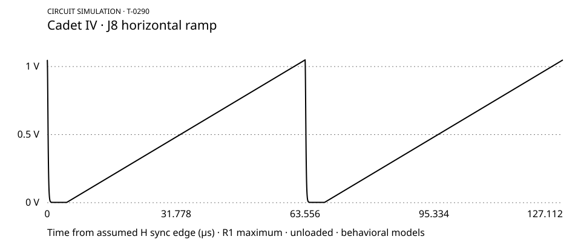

Circuit simulation · T-0290 · 13 October 2026

# Cadet IV: one horizontal ramp on this Mac

---

**Result:** ngspice runs on this Mac. The schematic transcription produces a repeating J8 ramp using behavioral and generic substitutes. Three downloaded TI models load, but their combined transient run fails. Neither run establishes fidelity to hardware.



[PDF plot](ramp.pdf) · [Samples](ramp.csv) · [Measurements](numbers.json) · [Successful circuit](ramp.cir) · [Model library](original.lib)

## Observed output

| Measurement | Result |
|---|---|
| **Range**, first saved complete line | 0.002162804–1.048384810 V |
| **Slope**, fit between 10 and 55 µs | 0.017813385 V/µs |
| **Linearity**, largest residual from that fit | 0.000065762 V |
| **Reset timing**, successive falling 0.5 V crossings | 0.220994855 and 63.777023378 µs |
| **Reset period**, difference between crossings | 63.556028523 µs |
| **Emitter resistor current**, first saved sample | 1.00243322 mA; this includes transistor base current |
| **Samples**, uniformly interpolated at 20 ns | 6,357 across two lines |

The run simulates 1.080452 ms and saves data after 953.34 µs: fifteen lines of settling. Ngspice reports 6,548 adaptive transient rows before interpolation. Measurement uses the first complete saved line. The plot shows both saved lines.

**Assumptions:** exact ±12 V bus supplies, nominal components, ngspice default temperature 27 °C, and no output load. R1 is at maximum, represented with a 0.01 Ω endpoint floor. Reset drive is an ideal 0/5 V pulse with 10 ns edges. Its period is 63.556 µs and high duration 4.7 µs. Charging therefore lasts approximately 58.856 µs. This timing is supplied, not discovered by simulation. Cadet I polarity and timing were not checked.

## Schematic and model coverage

The source is [LZX's locally saved schematic](../source/cadet-iv-dual-ramp-generator-schematics.pdf), V1.0, page 1. Its SHA-256 is `27a0ab4d03fb198bf8c8109a517cb62a12517ae840f78b498963af7df9108704`.

Page 1 was rendered with Poppler and visually inspected. The checked path includes R39/R42 10 kΩ, R43 1 kΩ, U10, U12.1, Q1, R44 4.99 kΩ, C29 56 nF, Q3, and R45 100 Ω. It continues through U12.2, R1 10 kΩ, R2 4.99 kΩ, U12.3, R50 499 Ω, and J8. Their connections match the earlier project transcription. The inverter and triangle branches remain attached because they load the ramp internally. The vertical channel is not instantiated.

| Part or block | Successful ramp | Vendor availability / tested status |
|---|---|---|
| **TL074**, U12 | Behavioral single-pole, slew-limited OPAMP | [TI TL074](https://www.ti.com/product/TL074), SLOJ068: downloaded and parsed; combined transient fails |
| **TL072**, U1.1 | Same behavioral OPAMP | [TI TL072](https://www.ti.com/product/TL072), SLOJ067: downloaded and parsed; combined transient fails |
| **TL431**, U10/U11 | Behavioral 2.495 V shunt, no REF input current | [TI TL431](https://www.ti.com/product/TL431), SLOJ174: downloaded and parsed; combined transient fails |
| **2N3906**, Q1 | Generic PNP card inherited from prior probe; vendor provenance unverified | No exact vendor model tested |
| **BS170**, Q3 | Level-1 MOSFET plus generic body diode | No exact vendor model tested |
| **LM6172**, U2 | Behavioral OPAMP with 100 MHz GBW and 3000 V/µs slew | [TI LM6172](https://www.ti.com/product/LM6172) lists SNOM234A; not downloaded or tested |
| **1N5711**, D5/D6 | Generic diode card | No vendor model tested |
| **1N4001**, D1/D2 | Generic diode card in power entry | No vendor model tested |
| **7805 / 74HC14**, regulator / sync logic | Omitted; ideal reset voltage substitutes for their output | No models tested |
| **Resistors / capacitors / trimmer** | Native ideal SPICE elements | Usable in successful run; no tolerance, dielectric, or parasitic models |
| **Ferrites / jacks / bypass network** | Ferrites: 0.1 Ω; jacks unloaded; most bypass capacitors omitted | No frequency-dependent ferrite or connector model |

The behavioral op-amps omit offset, bias current, and supply current. The negative rail consequently stays at −12 V despite its protection diode. Reset pedestal, edge speed, noise, and millivolt offsets remain unvalidated. Model availability on a vendor page does not establish ngspice compatibility.

## Exact vendor failure

[Vendor deck](vendor-attempt.cir) uses [circuit.lib](circuit.lib), with TI TL072, TL074, and TL431 substitutions. TL074/TL072 pins are `+input −input +supply −supply output`. TL431 pins are `REF A K`; U10 was reordered accordingly. Model extraction only normalizes CRLF and removes the final DOS EOF byte.

`ngspice -b vendor-attempt.cir` returns **1**. [The saved log](vendor-attempt.log) reports:

```text
No. of Data Rows : 0
doAnalyses: TRAN:  Timestep too small; time = 1.5625e-12, timestep = 2.5e-20: trouble with xh.xu12d:jx-instance j.xh.xu12d.j1
run simulation(s) aborted
```

This identifies the stopping point, not its underlying cause. Independent model tests, convergence tuning, and further vendor substitutions were not performed. `circuit.lib` retains the original comments describing replaced blocks; the actual instances and this inventory identify the models used.

## Rerun offline

No installation is needed on this Mac. Observed environment: Darwin arm64, `/opt/homebrew/bin/ngspice`, **ngspice-47**, Python **3.14.6**. [Version output](version.txt) records KLU compilation; the simulation log reports SPARSE 1.3 during analysis.

From `/Users/donovan/work/phosphlux`:

```sh
python3 -I research/devices/lzx_cadet_iv/probe-t0290/run.py
```

The runner executes both decks from their own directory. Vendor exit **1** is recorded as the failed experiment; behavioral exit **0** produces the measurements and plots. It uses only Python's standard library. All circuit dependencies are saved beside this page. It overwrites only this probe's generated outputs.

Expected measured data SHA-256:

```text
56748ec29569943c34261bf09148194bd7c86b361021a41713d990805f5450ec  ramp.dat
```

Exact bytes matched on repeated runs on this Mac. Other simulator versions may require numerical comparison rather than byte identity.

## Acquisition and checks performed

The existing `sim/cadet_iv.lib` was copied unchanged into `original.lib`. App code and earlier results were not changed.

The following downloads succeeded with curl, each returning exit **0**. Archives are saved here; no fetched software was installed.

```sh
curl -L --fail --max-time 30 https://www.ti.com/lit/zip/sloj068 -o .scratch/t0290/sloj068.zip
curl -L --fail --max-time 30 https://www.ti.com/lit/zip/sloj067 -o .scratch/t0290/sloj067.zip
curl -L --fail --max-time 30 https://www.ti.com/lit/zip/sloj174 -o .scratch/t0290/sloj174.zip
```

| Archive | SHA-256 |
|---|---|
| **sloj068.zip**, TL074.301 | `c20622bd9f4eb6e5fd2277ecab9810b7979574e194b10393807db964369960ef` |
| **sloj067.zip**, TL072.301 | `db3af55a18021e1a8d30ef4ca324c388e734fa3d9c3cf20a631fead224440d8e` |
| **sloj174.zip**, tl431.mod | `7723fca410c50e1b893e1a02ce1f61288e26cf7f87b511e5b08c768f57bf67c2` |

An initial preparation command used the wrong working directory and raised `FileNotFoundError` for the downloaded archive. It was corrected before circuit generation. A shell command that printed the first failed vendor log masked ngspice's exit status; subsequent subprocess runs directly recorded exit **1**.

The final runner returned exit **0**, reproduced the sample hash and measurements, and retained the vendor failure. `pdftoppm` rendered the final PDF plot with exit **0**. Visual inspection confirmed two rising ramps, low reset plateaus, readable axes, and no clipped labels. Browser inspection was unavailable; the PDF rendering supplied the visual check.

**What follows:** T-0293 already covers selecting the reference and writing match criteria. T-0327/T-0299 cover review of the existing faithful draft. No duplicate follow-up is proposed. These outputs support an explicitly provisional behavioral reference; they do not certify the vendor models or a real Cadet IV match.
